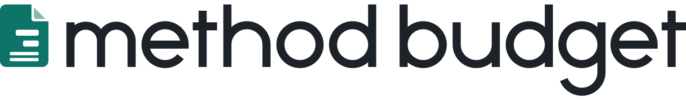

<p align="center">
  <picture>
    <source media="(prefers-color-scheme: dark)" srcset="site/assets/brand/wordmark-dark.svg">
    
  </picture>
</p>

<p align="center"><strong>Film and TV budgeting that shows its working.</strong></p>

<p align="center">
  <a href="https://methodbudget.com">methodbudget.com</a> ·
  <a href="docs/INSTALL.md">Install</a> ·
  <a href="docs/CLI.md">Command line</a> ·
  <a href="docs/FORMAT.md">File format</a> ·
  <a href="docs/ROADMAP.md">Roadmap</a>
</p>

Method Budget is a free, open-source desktop app for building and running production
budgets: topsheet, accounts and detail lines, fringes, globals, groups, charges and
credits, versions and cost reports. It keeps your budgets as plain, documented files on
your own disk, works offline, and never needs an account.

<!-- Screenshots go here once we have our own captures of the app (an invented sample
     budget, never a real one, and never another product's screens). Planned markup:
<p align="center">
  <picture>
    <source media="(prefers-color-scheme: dark)" srcset="docs/assets/screens/budget-dark.png">
    
  </picture>
</p>
-->

## Highlights

- **Your budget is an open file.** Budgets are `.mthd` files: plain, documented JSON
  ([docs/FORMAT.md](docs/FORMAT.md)). Any tool can read them, they diff cleanly, and you
  are never locked in.
- **Local first.** Everything lives on your disk and works offline. No account, no cloud,
  no telemetry. The app goes online only to check for its own updates, and you can turn
  that off.
- **Keyboard first.** Drill into an account, climb back to the topsheet, step between
  accounts, fill down and move rows without reaching for the mouse.
- **Every number explains itself.** Pick any total and trace it down to the lines,
  fringes, cutoffs and rounding steps that make it up. Money is kept in whole cents, so
  the topsheet always adds up.
- **Scriptable.** The `method` command line runs the same engine with no window, and a
  git merge driver combines two people's edits to one budget.
- **No subscription.** Free and open source under MIT or Apache-2.0.

## Features

The list below is generated from [docs/features.toml](docs/features.toml) by
`python3 scripts/site.py`, which also writes the list on the website. Edit that file, not
this section.

<!-- features:start (generated by scripts/site.py from docs/features.toml: edit that, then run python3 scripts/site.py) -->
### Budgeting engine

- **Topsheet, accounts and detail lines.** The familiar three levels, with every total rolling up live as you type.
- **Money exact to the cent.** Every amount is kept in whole cents, never floating point, with one documented rounding rule, so the topsheet always adds up.
- **Formulas and globals.** Amount, quantity and rate cells take formulas and named globals; change a global and every line that uses it follows.
- **Currencies.** Any line can be in its own currency, converted to the budget's base currency at rates you set.
- **Groups and what-ifs.** Tag lines into groups, leave a group out of the total to see a what-if, and get back to the exact cent when you put it back.
- **Explain this number.** Trace any total down to the lines, fringes, cutoffs, ranges and rounding steps that make it up.
- **Overtime helper.** Work out a day or a week of straight time, overtime bands and sixth and seventh days, then write the pay into the line.
- **Fast on big budgets.** An edit recalculates in about 5 ms on a 5,000-line budget.

### Fringes, globals, charges and credits

- **Fringes with cutoffs and ranges.** Percent and flat fringes, cutoffs per earner, fringe ranges across several lines, unit-hour flats and four ways to post them.
- **Globals with details.** Give a global a description, a unit and decimals, show it by name in cells, and see the formulas behind a selection.
- **Contractual charges.** Percent and flat charges with exclusions, a live preview while you type, and the percent shown on the topsheet if you want it.
- **Credits.** Credit rows show gross, excluded fringes, net and how far you are from a cap.
- **Apply panel.** Select lines, then tick fringes, groups, sets and locations on or off, with live totals for the selection.
- **In-use counts.** Every setup list shows how many lines use each item and what they cost, warns before you delete one in use, and finds them in a click.

### Editing, split view and history

- **Keyboard-first grid.** Drill in, climb out, step between accounts, fill down and move rows without touching the mouse; a shortcut sheet lists every key.
- **Type-ahead and add on the fly.** Units, currencies, sets, locations and globals complete as you type, and a new one can be added right from the cell.
- **Never lose work.** Autosave into the file, recovery copies for untitled budgets, rolling backups and a restore after a crash.
- **Budget tabs and split view.** Open several budgets as tabs, each with its own undo, and put two side by side in one window.
- **History list.** Every undo step is listed by name and time; click one to go back to it, or save it as a version.
- **Find and replace.** Search descriptions, account numbers, fringes, globals, groups, notes and formulas, then replace only in the results you tick, as one undo step.
- **Copy rows with everything on them.** Rows keep their fringes, groups, notes, style and ranges when copied, even between budgets, with a review of what the paste will change.
- **Notes.** Dated notes on lines, accounts and categories, and a notes list that works as a review checklist.

### Versions, compare, diff and merge

- **Named versions.** Save, rename, annotate and restore versions, all kept inside the budget file.
- **Compare up to 16 budgets.** Versions or other files side by side at topsheet and account level, with sum, average and variance columns, down to detail lines.
- **Original and variance columns.** Keep a locked baseline and see each account's change from it right in the grid.
- **What changed.** A plain-words diff of two budgets or versions: every changed line, field and setup item, with the money it moved.
- **Three-way merge.** Two copies that changed apart merge on their own where they touched different things; real clashes are listed for you to pick.
- **Share-ready copies.** Save a dated snapshot, optionally without notes or private info, that opens read-only and compares back against the original.
- **Small version history.** Versions can be stored as compact patches, so ten versions of a large budget take about the space of one.

### Actuals and cost reports

- **Import actuals.** Bring in transactions from CSV, tab-delimited or Excel accounting exports with a column mapping, duplicate checks and a review of unknown accounts.
- **Cost report.** Budget, actual to date, estimate to complete and variance by account, with each account's estimate method your choice.

### Reports, PDF and spreadsheets

- **Reports saved in the budget.** Pick sections, accounts and layout, save them as named presets with header and footer fields, and print straight to PDF.
- **Live preview.** The setup dialog shows the printed pages as you change them, with page navigation and a jump list of sections.
- **More than the topsheet.** Category summaries, account detail, setup tables, chart of accounts, group totals, budget information and a notes list.
- **Spreadsheet export.** One Excel workbook with topsheet, accounts, detail and setup tables, plus CSV and tab-delimited files for accounting.
- **Spreadsheet import.** Turn any department's Excel, CSV or tab-delimited sheet into budget lines with a column mapping and a line-by-line check of the totals.
- **Import from other budgeting apps.** Open a budget from another program's JSON, XML, Excel or tab-delimited export, with a line-by-line check against that program's own totals.

### Setup library and templates

- **Start from another budget.** Import setup items from any budget, with what they depend on, or start a new budget from a template.
- **Personal setup library.** Keep your fringes, globals, groups and the rest in a library file of your own and copy them in and out with a conflict review.
- **Tag presets and line blocks.** Save a set of tags or a block of lines once and apply or insert them anywhere.
- **Rename everywhere.** Rename a fringe, global, group or unit and every reference follows, formulas included, as one undo step.
- **Renumber accounts.** Change the account numbering pattern and preview every old and new number before it applies.
- **Sub-budgets.** Make a filtered copy by categories, accounts, groups, sets or locations, for a department or a unit.

### Command line and git

- **Open file format.** Budgets are `.mthd` files: plain, documented JSON that diffs cleanly and that any tool can read.
- **Scriptable command line.** `method` checks budgets, prints totals, draws reports as PDF, HTML or CSV, and exports and imports spreadsheets, with no window and no network.
- **Batch edits.** `method set` and `method apply` run edit scripts all or nothing, with a dry run that shows what would change.
- **Git merge driver.** Keep budgets in git and let `method merge-driver` merge edits to different lines, flagging only real conflicts.

### On the roadmap

- **Signed and notarized Mac app.** Install on a Mac without the one-time security step.
- **Windows and Linux, tested.** Installers for both are built today; printing, keys and file types still need a hands-on check.
- **Review files.** A reviewer marks up a read-only copy, and their comments come back in a small file you merge.
- **Incentive modeling.** Qualified spend by location, several programs side by side, caps and what-ifs, from rules you enter yourself.
- **Schedule-linked quantities.** Read day counts from a schedule's export and let them drive your globals.
- **Accessibility and translations.** A full accessibility pass and the app in more languages.

<!-- features:end -->

## Install

Method Budget is a desktop app for macOS, with Windows and Linux builds that have not been
tested by hand yet. **Ready-made downloads are not public yet.** Until they are, build it
from source. [docs/INSTALL.md](docs/INSTALL.md) covers building, installing on a Mac, the
one-time security step for builds that are not notarized, and what signed releases need.

### Build from source

Get the code:

<!-- clone:start (generated by scripts/site.py from docs/features.toml: edit that, then run python3 scripts/site.py) -->
```bash
git clone https://github.com/ssandweiss/method-budget.git
```
<!-- clone:end -->

You need [Rust](https://rustup.rs) (the version is pinned in `rust-toolchain.toml`, and
rustup picks it up on its own). There is no JavaScript toolchain: no npm, no bundler.

```bash
cargo test --workspace            # the engine, the file format, the command line and the app
cargo run -p method-app           # run the desktop app
```

On Linux, install the WebKitGTK build packages first (listed in [docs/APP.md](docs/APP.md)).
Installers (`.app` and `.dmg`, `.msi`, `.deb` and `.AppImage`) are built with the pinned
Tauri CLI, as [docs/INSTALL.md](docs/INSTALL.md) describes.

## Command line quickstart

The `method` command reads and writes budgets without the app: same engine, no window, no
network. Install it from a checkout:

```bash
cargo install --path crates/method-cli --locked
```

Then:

```bash
method new my-film.mthd                      # a starter budget
method show my-film.mthd                     # the topsheet
method check my-film.mthd                    # recalculate and report problems
method totals my-film.mthd --json            # every total, in cents, for scripts
method explain my-film.mthd net              # how a total is made up
method report my-film.mthd --sections topsheet -o topsheet.pdf
method export my-film.mthd --xlsx my-film.xlsx
method diff old.mthd new.mthd                # what changed, in plain words
```

Every command, flag and exit code is in
[docs/CLI.md](docs/CLI.md).

### Budgets in git

Budgets are text with stable ids inside, so git can merge two people's edits. Tell git
to use the merge driver:

```bash
echo '*.mthd merge=method' >> .gitattributes
git config merge.method.name "Method Budget merge"
git config merge.method.driver "method merge-driver %O %A %B %P"
```

Edits to different lines merge on their own; real clashes are left for you to settle in
the app. Details: [docs/MERGE.md](docs/MERGE.md).

## Coding agents

`method mcp` is an MCP server, so Claude Code and other MCP clients can open, read and edit
budgets with typed tools: lines, globals, fringes, charges, totals, explain, export, import and
undo, all through the same engine and the same exact arithmetic as the app. It only touches
files inside the folders you give it, writes atomically, won't overwrite a file someone else
just saved, and has a read-only mode. Nothing is sent anywhere.

```bash
claude mcp add method -- method mcp --root ~/Budgets
```

Every tool and the safety model: [docs/MCP.md](docs/MCP.md).

## File format

Budgets are pretty-printed JSON with a fixed key order, money as integer cents and
decimals as strings, so the same budget always produces the same bytes. The full
specification is [docs/FORMAT.md](docs/FORMAT.md). It is ours to document and yours to
use: write tools that read or produce it.

## Templates and charts of accounts

Any budget can be a template: File > New From Template starts a new budget from another
one's chart of accounts, setup and settings without its lines, and File > Save as
Template writes one. Starter templates with charts of accounts written for this project
are being added now.

## Clean room

Method Budget is an independent, clean-room project by the Method Budget contributors,
not affiliated with Entertainment Partners or Movie Magic Budgeting. Trademarks belong to
their respective owners. It uses no other vendor's code, templates, help text, icons or
data, and reads budgets from other tools only through the open files they export. The
rules every contribution follows are in [CLEAN-ROOM.md](CLEAN-ROOM.md).

## Contributing

Bug reports and patches are welcome. Read [CLEAN-ROOM.md](CLEAN-ROOM.md) first: it is
short, and it is the one hard rule. Please never attach a real budget to an issue; an
invented one that shows the problem (`method sample` makes a large test budget) is always
enough. Design choices and their reasons are numbered in
[docs/decisions.md](docs/decisions.md), what comes next is in
[docs/ROADMAP.md](docs/ROADMAP.md), and how the project looks and sounds is in
[docs/BRAND.md](docs/BRAND.md).

## License

Dual-licensed under [MIT](LICENSE-MIT) or [Apache-2.0](LICENSE-APACHE), at your option.
Contributions are accepted under the same terms.
